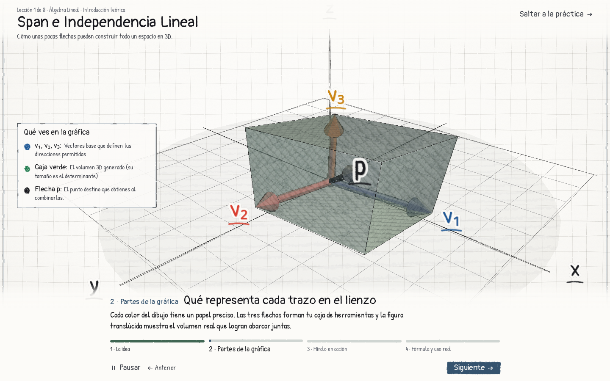
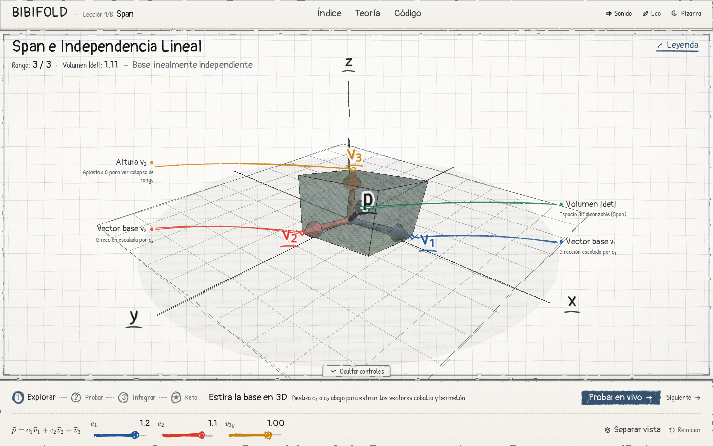
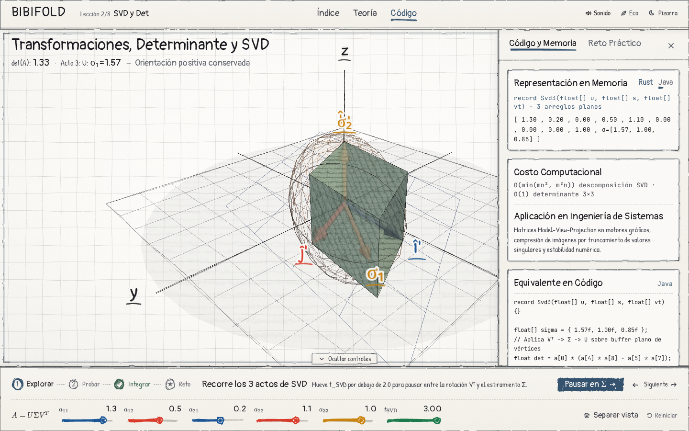
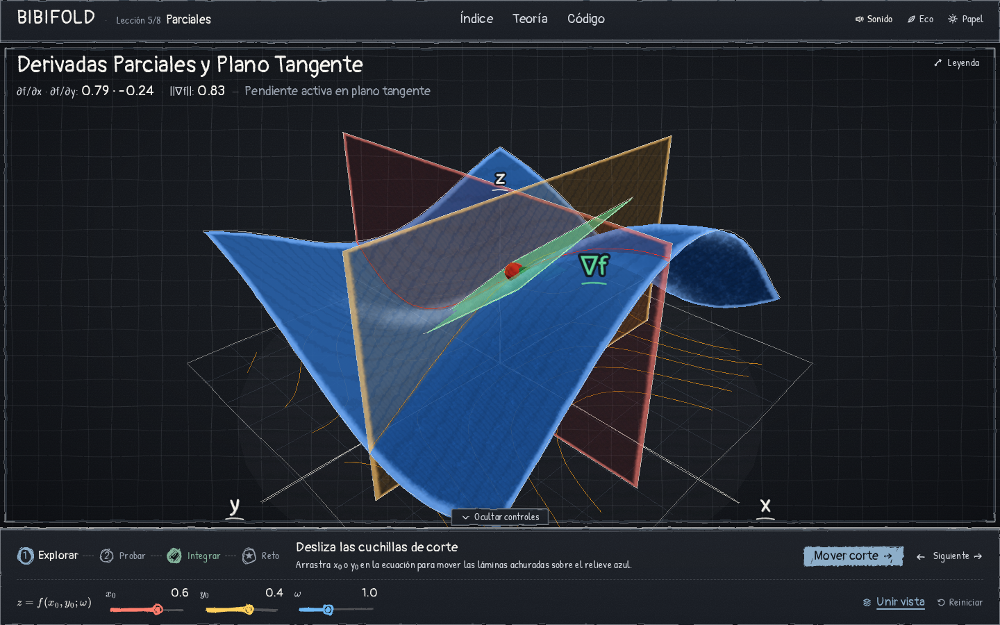
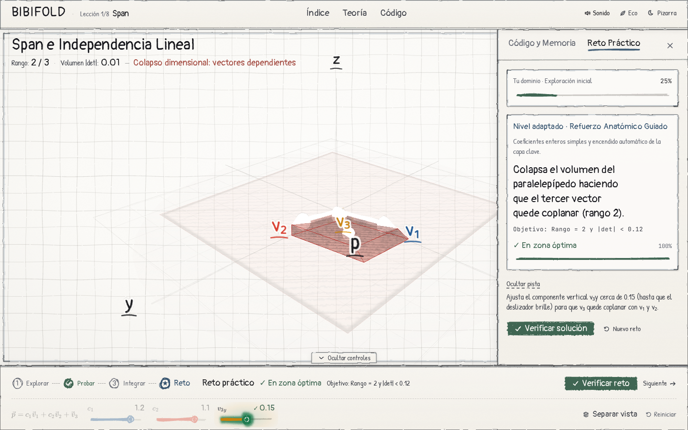

# BIBIFOLD

**Interactive 3D Crayon Sketchbook for Systems Engineering Mathematics.**

BIBIFOLD transforms Linear Algebra and Multivariable Calculus into tactile, hand-drawn 3D interactive visualizations. Every geometric object—vectors, eigenspaces, singular value decompositions, tangent planes, and vector fields—builds itself stroke by stroke on textured paper or dark chalkboard, paired with live **Rust** and **Java** memory layouts and an on-device adaptive challenge engine.



---

## Key Features

- **Procedural Stroke-by-Stroke 3D Sketching**: Custom Three.js GLSL wax-crayon shaders and Rough.js SVG accents draw each mathematical scene in real time—layer by layer from coordinate substrate to vectors, surfaces, and annotations—across **Paper** (`Papel`) and **Chalkboard** (`Pizarra`) themes.
- **4-Beat Animated Theory Intros**: Every lesson opens with a narrated, video-like interactive walkthrough (*Idea → Parts of the Graph → Watch It Live → Formula & Real Use*) that smoothly animates parameters and rebuilds the 3D scene as you follow along.
- **Interactive Legend & Idle Crayon Guide**: Toggle handcrafted callouts (`Leyenda`) projected directly onto 3D anatomical anchors, or pause for 5 seconds to reveal a gentle animated crayon arrow pointing to the highest-impact control.
- **Systems Memory & Rust / Java Code Bridge**: Inspect how each mathematical structure maps to contiguous buffers, cache alignment, and numerical kernels in real time—switching seamlessly between **Rust** and **Java** with live parameter updates.
- **Exploded Anatomical View (`Separar vista`)**: Vertically separate stacked 3D layers (contours, base meshes, slicing planes, tangent surfaces, and vector invariants) to inspect complex multi-layer geometry without visual occlusion.
- **On-Device Adaptive Challenges (Edge AI)**: Runs Bayesian Knowledge Tracing (BKT) and a LinUCB contextual bandit inside a dedicated Web Worker to tune challenge difficulty, provide optimal-zone visual feedback on sliders, and track mastery locally.
- **Procedural Web Audio Crayon Engine & Eco Mode**: Synthesizes organic wax-on-paper friction strokes, construction glides, and legend taps via the Web Audio API (zero audio asset files), while **Eco Mode** lowers GPU load, mutes audio, and switches annotations to cursor-reactive opacity.

---

## Visual Walkthrough

### Hands-On 3D Lab & Projected Anatomy Legend
Manipulate equation parameters directly in the bottom equation bar while crayon dust reacts to rapid edits and projected callouts explain each 3D element.



### Systems Engineering Bridge: Rust & Java Memory Layouts
Open the `Código y Memoria` drawer on any lesson to compare idiomatic **Rust** (`[f32; 9]`, `f32x4`, zero-copy slices) and **Java** (`record`, `float[]`, contiguous matrix layouts) alongside live parameter values.



### Chalkboard Mode & Exploded Multi-Layer Calculus
Switch to dark Chalkboard (`Pizarra`) and toggle `Separar vista` to inspect partial derivative slice planes, contour curves, and tangent planes in full clarity.



### Adaptive Challenges & Optimal-Zone Crayon Glow
Test your geometric intuition in `Reto Práctico`: as your parameters approach the mathematical target (e.g., collapsing a 3D parallelepiped to rank 2), the active slider illuminates with a soft green crayon aura and updates your mastery score.



---

## Curriculum (8 Interactive Lessons)

| # | Module | Lesson | Core Geometric Concept |
| :-: | :--- | :--- | :--- |
| 1 | Linear Algebra | **Span & Linear Independence** | Parallelepiped volume, rank collapse ($\|\det\| \to 0$) |
| 2 | Linear Algebra | **Singular Value Decomposition (SVD)** | Unit sphere mapped into ellipsoid via $U \Sigma V^T$ |
| 3 | Linear Algebra | **Eigenvalues & Eigenvectors** | Invariant directions, scaling factors, and rotation regimes |
| 4 | Linear Algebra | **Orthogonal Projections & Least Squares** | Subspace projection $\hat{y}$ and orthogonal residual error $e \perp \text{Col}(A)$ |
| 5 | Multivariable Calculus | **Partial Derivatives & Tangent Plane** | Coordinate slices $\partial f/\partial x$, $\partial f/\partial y$, and local linear approximation |
| 6 | Multivariable Calculus | **Gradient & Directional Derivative** | Steepest ascent vector $\nabla f$ and steepest-descent path |
| 7 | Multivariable Calculus | **Double Integrals (Riemann Sums)** | Volume under $z = f(x, y)$ partitioned into interactive columns |
| 8 | Multivariable Calculus | **Divergence & Curl** | Flux expansion and local rotation in 3D vector fields |

---

## Tech Stack

- **Frontend**: React 19, TypeScript, Vite, Tailwind CSS v4
- **3D & Hand-Drawn Rendering**: Three.js (custom GLSL wax-crayon, charcoal hatch, and paper-grain shaders), Rough.js, KaTeX
- **Audio & Adaptation**: Web Audio API procedural noise synthesizer, Web Worker Edge AI (BKT + LinUCB), IndexedDB / `localStorage` persistence

---

## Getting Started

```bash
# Install dependencies
npm install

# Start the development server on http://localhost:3000
npm run dev

# Type-check with TypeScript
npm run lint

# Build for production
npm run build
```

### Run Unit Tests

```bash
npx tsx --test src/**/*.test.ts
```
